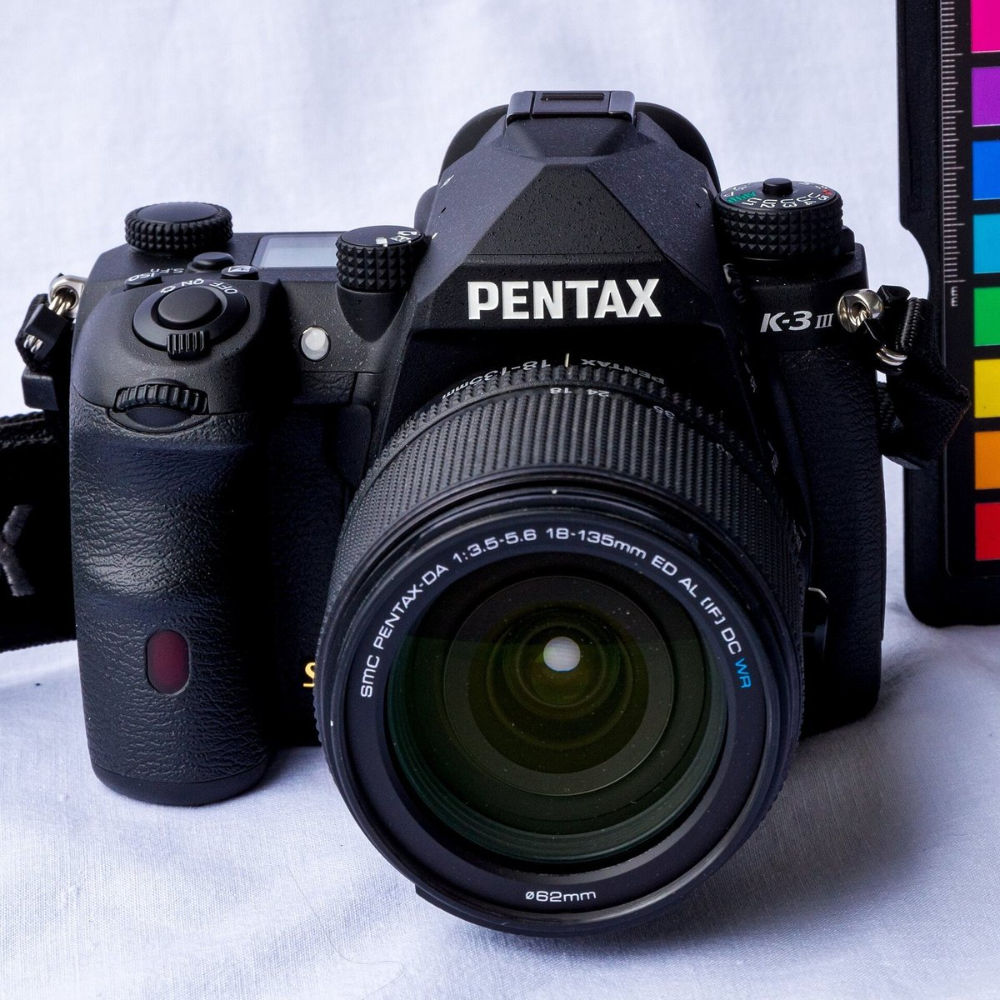

# PENTAX K-3 Mark III 펌웨어 2.20 분석

리코가 배포한 K-3 Mark III 펌웨어 `fwdc233b.bin`을 풀어, 카메라가 부팅하고 사진의 색을 만들고 초점을 맞추고 메뉴를 그리는 코드를 추적한 연구 기록입니다. K-3 II·Q7과 함께 진행하는 세 기종 연구의 중심 저장소이기도 합니다.

**문서는 여기서 읽습니다 → [https://yunhyok.github.io/pentax-k3iii-firmware-analysis/](https://yunhyok.github.io/pentax-k3iii-firmware-analysis/)**



<sub>사진: © Jörgens.Mi/Wikipedia, [CC BY-SA 3.0](https://creativecommons.org/licenses/by-sa/3.0/), [Wikimedia Commons](https://commons.wikimedia.org/wiki/File:Pentax_K3III_jm136770_ji.jpg) (크기 축소). 자세한 출처는 [assets/photos/CREDITS.md](assets/photos/CREDITS.md).</sub>

> **먼저 알아 둘 점.** 모든 분석은 PC에서 했습니다. 수정한 펌웨어를 카메라에 설치하거나 실행한 적이 없습니다. 이 저장소에는 카메라에 넣을 수 있는 펌웨어가 없고, 원본 펌웨어와 제조사 코드도 없습니다.

## 무엇을 알아냈나

세 기종(K-3 Mark III, K-3 II, Q7)을 같은 네 가지 질문으로 조사합니다. K-3 Mark III에서 온 지점은 다음과 같습니다.

| 질문 | 알아낸 것 | 아직 모르는 것 |
|---|---|---|
| 펌웨어를 고쳐서 다시 만들 수 있는가 | 무변경 재포장이 배포본과 바이트까지 같음. 색 행렬 함수를 C로 다시 짜서 넣은 후보가 원본 코드의 헤더·체크섬 검사를 통과 | 카메라가 수정본을 받아들이는지, 부팅하는지, 부팅 단계의 인증 |
| Lightroom에서 카메라의 색을 낼 수 있는가 | 색 모드별 행렬·감마 조건. 시험용 프로파일(DCP)을 실제 Lightroom Classic에 적용해 TIFF 출력 | 카메라 JPEG와 얼마나 가까운지 (색차 실측은 K-3 II RAW 한 장) |
| AF 동작을 바꿀 수 있는가 | AF 계산의 기본 연산, 렌즈 능력에 따른 구동 방식 분기, 요청 큐와 완료 통지 | 실제 렌즈 통신·모터 이동·초점 정확도 |
| 이 카메라의 화면을 다른 기종에 옮길 수 있는가 | 색공간 선택 화면의 선택·확정·취소와 입력 처리, 아이콘 자원 형식 | 실제 버튼 입력에서 LCD까지. 이식은 시작하지 않음 |

세 기종을 나란히 비교한 현황은 [세 기종 연구 본부](https://yunhyok.github.io/pentax-k3iii-firmware-analysis/analysis/research-program.html)에 있습니다.

## 문서 안내

주제마다 안내 문서가 있습니다. 안내 문서에서 전체 그림을 본 뒤 세부 문서로 들어가면 읽기 쉽습니다.

| 주제 | 안내 문서 |
|---|---|
| 시작하기 | [개요](https://yunhyok.github.io/pentax-k3iii-firmware-analysis/) · [펌웨어 구조와 하드웨어](https://yunhyok.github.io/pentax-k3iii-firmware-analysis/analysis/firmware-structure.html) · [세 기종 연구 본부](https://yunhyok.github.io/pentax-k3iii-firmware-analysis/analysis/research-program.html) · [용어집](https://yunhyok.github.io/pentax-k3iii-firmware-analysis/glossary.html) |
| 부팅과 저장소 | [부팅과 저장소 안내](https://yunhyok.github.io/pentax-k3iii-firmware-analysis/analysis/guide-boot.html) |
| 펌웨어 업데이트 과정 | [업데이트 과정 안내](https://yunhyok.github.io/pentax-k3iii-firmware-analysis/analysis/guide-update.html) |
| 펌웨어 재구축 | [재구축 안내](https://yunhyok.github.io/pentax-k3iii-firmware-analysis/analysis/guide-rebuild.html) |
| RTOS 명령과 셸 | [RTOS 명령 안내](https://yunhyok.github.io/pentax-k3iii-firmware-analysis/analysis/guide-rtos.html) |
| 카메라 내부 색 처리 | [색 처리 안내](https://yunhyok.github.io/pentax-k3iii-firmware-analysis/analysis/guide-color.html) |
| Lightroom 색 프로파일 (세 기종) | [DCP 생성·검증 개요](https://yunhyok.github.io/pentax-k3iii-firmware-analysis/analysis/lightroom-bridge.html) |
| AF와 렌즈 제어 (세 기종 비교) | [세 기종 AF 기초 비교](https://yunhyok.github.io/pentax-k3iii-firmware-analysis/analysis/af-foundations.html) |
| UI와 화면 자원 (세 기종 비교) | [UI 이식 설계](https://yunhyok.github.io/pentax-k3iii-firmware-analysis/analysis/ui-port-contract.html) |

문서는 결과마다 얼마나 확실한지를 네 가지로 표시합니다: **확인**(원본 코드를 PC 에뮬레이터에서 실행해 관측), **정적 분석**(코드를 읽어서 판단), **모델**(실물 대신 넣은 값), **미확인**. 자세한 뜻은 [개요의 “검증 수준 읽는 법”](https://yunhyok.github.io/pentax-k3iii-firmware-analysis/#levels)에 있습니다.

GitHub에서 HTML 파일을 열면 소스가 보입니다. 오프라인으로 읽으려면 저장소를 내려받아 `index.html`을 브라우저로 여세요.

## 직접 확인하기

펌웨어 없이, 공개된 문서·근거 파일·도구가 서로 맞는지 검사합니다. Python 3.12와 아래 패키지가 필요합니다.

```bash
python -m pip install unicorn==2.1.4 numpy==1.26.4 Pillow==10.4.0 tifffile==2023.4.12 opencv-python-headless==4.11.0.86 scikit-image==0.24.0
python inspect_firmware.py --self-test
python verify_findings.py --self-test
python inspect_adobe_profiles.py --self-test
python -m unittest discover -s tests -v
python tools/check_research_program.py
python tools/check_site.py
```

리코 공식 사이트에서 받은 `fwdc233b.bin`이 있으면 압축 해제부터 다시 해 볼 수 있습니다.

```bash
python inspect_firmware.py fwdc233b.bin --output-dir .private/my-decode
python verify_findings.py .private/my-decode/decoded.bin
```

주제별 검증기(`verify_*.py`, `tools/*.py`)의 사용법은 각 문서의 “재현 방법” 절에 있습니다.

## 저장소 구성

| 경로 | 내용 |
|---|---|
| `index.html`, `glossary.html`, `analysis/*.html` | 분석 문서 |
| `analysis/*.json`, `analysis/*.tsv`, `evidence.json` | 측정 결과(근거 파일) |
| `analysis/research-program.json` | 세 기종 현황 데이터. `tools/build_research_program.py`가 HTML로 만듭니다 |
| `inspect_firmware.py`, `verify_*.py`, `tools/` | 분석·검증 도구 |
| `source/` | 재배포 조건을 확인한 공개 소스 사본과, 직접 작성한 재구성 C 코드(`source/reconstructed/`) |
| `tests/` | 단위 테스트 |
| `assets/`, `site-map.json`, `tools/site_chrome.py`, `tools/check_site.py` | 문서 스타일, 문서 목록, 내비게이션 갱신·검사 도구 |
| `docs/releases/` | 릴리스 노트 |

문서를 추가하거나 순서를 바꿀 때는 `site-map.json`을 고친 뒤 `python tools/site_chrome.py`를 실행하면 모든 문서의 상단 메뉴와 이전·다음 링크가 갱신됩니다.

## 릴리스

[릴리스 목록](https://github.com/yunhyok/pentax-k3iii-firmware-analysis/releases)에서 문서와 도구를 묶은 ZIP과 SHA-256을 받을 수 있습니다. `docs/releases/<태그>.md`를 main에 병합하면 릴리스 워크플로가 검사를 돌린 뒤 릴리스를 만듭니다.

## 공개 범위

공개 자료는 직접 작성한 분석·검증 도구, 측정 결과, 재배포 조건을 확인한 공개 소스 사본입니다. 원본 펌웨어, 추출한 계수, 제조사 코드의 디컴파일 결과는 공개하지 않습니다. 제조사의 비공개 소스나 전체 펌웨어 빌드 환경을 복구한 것이 아닙니다. 사진의 라이선스는 [assets/photos/CREDITS.md](assets/photos/CREDITS.md)에 따로 적었습니다.

## 관련 저장소

- [K-3 II 펌웨어 분석](https://github.com/yunhyok/pentax-k3ii-firmware-analysis)
- [Q7 펌웨어 분석](https://github.com/yunhyok/pentax-q7-firmware-analysis)
