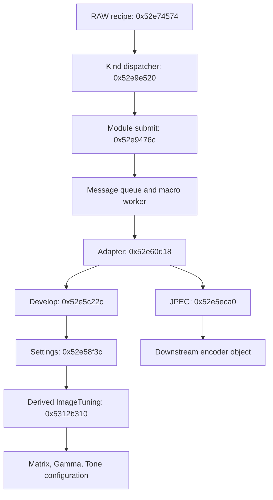

# K-3 Mark III v2.20 색 처리 알고리즘 후속 분석

대상 RTOS의 SHA-256은 `342d2f35405e8daf1797dfe431d2e4aa70f4b52a2c242a29df48206672f1dfb4`, 적재 기준은 `0x52500000`이다. 원본 ARM 코드, 로컬에 저장한 디컴파일 결과, 합성 입력의 격리 실행을 대조했다. 아래 함수명은 진단 문자열 또는 분석자가 붙인 이름이다. 제조사 원본 소스, 전체 소프트웨어 현상기, 실기 RAW/JPEG 일치를 확보했다는 뜻은 아니다. [코드 구간·호출 위치·해시](deep-evidence.json) · [모드별 리소스 색인](color-resources.json)

## 색 행렬·채도·색상 조절

`0x5312ce30`은 모드 디스크립터의 공통 행렬 `B`, 모드 행렬 `M`, 필터/채도 행렬 `F`를 아래 순서로 합성한다. `A`는 ColorSpace 관련 조건이 켜졌을 때 추가되는 고정 행렬이다. `Mul16_Q13`·`Mul32_Q13`의 16·32는 저장 폭이고, 산술 단위는 모두 8192다. 이 식은 **계수 합성 순서**이며 픽셀의 통과 순서나 센서→XYZ 변환을 뜻하지 않는다. [코드·리소스 해시](deep-evidence.json) · [독립 정수 모델](../verify_color_math.py)

```text
T = Mul16_Q13(F, M)
U = ColorSpace 조건 ? Mul16_Q13(A, T) : T
V = Mul32_Q13(sign_extend(U), sign_extend(B))
```

`Mul16_Q13(0x5312cd40)`은 32비트 누산에 4096을 더하고 논리 우측 이동 13 후 하위 16비트를 남긴다. `Mul32_Q13(0x5312cdb4)`는 더한 결과의 부호에 따라 보정한 뒤 산술 이동한다. 예를 들어 내적 합이 `-8192`이면 앞 함수는 `-1`, 뒤 함수는 `0`을 만든다. 중간의 부호 확장·폭 축소·오버플로 처리를 생략한 실수 행렬곱은 정확히 같은 결과를 보장하지 않는다.

채도는 공통 설정 `+0x264f → tuning +0x1f8 → 파라미터 +0x57`로 이어진다. 0..8은 아홉 개의 **명시적인 행렬**을 고르고 범위를 벗어나면 인덱스 4를 쓴다. 일반 채도식을 가정해 이 테이블을 대신할 근거는 없다. 필터 override와 수동 RGB 분기가 있으며, 수동 RGB는 같은 `[R,G,B]` 행을 세 번 반복한 행렬을 만든다. 상위 코드의 필터값 9가 이 분기를 선택한다. [제어값의 생산·소비 위치](deep-evidence.json)

합성 후에는 룩업과 런타임 값으로 계산한 gain을 곱하고, 4096으로 나눠 0 방향으로 자른 뒤 signed16으로 좁힌다. 수동 RGB가 아니면 대각 원소를 다시 써서 각 행의 합을 `2*gain`으로 맞춘다. 이후 각 계수를 `[-2048,2047]`로 제한하고 설정 버퍼 `+0x20..+0x30`의 하위 12비트에 패킹한다. 클리핑 후에는 앞의 행 합 조건이 깨질 수 있다. 이는 설정 계수의 폭이며, 하드웨어 픽셀 누산 폭이나 센서 데이터의 비트 수가 아니다.

색상(Hue) `+0x2650 → tuning +0x1fa → 파라미터 +0x5c`는 별도의 **YCbCrMatrix** 경로에서 처리한다. `0x53132698`이 아홉 행렬 중 하나를 고르고, `0x53132628`이 고정 우측 행렬과 곱한 결과의 하위 9비트를 설정 `+0x1180..+0x1190`에 쓴다. 이 곱셈은 부호 보정 없이 논리 이동하므로 앞의 Mul32와도 다르다. 두 디스크립터 계열 중 하나는 모든 Hue 인덱스가 같은 단위행렬을 가리킨다. 행렬의 의미와 제어 위치는 확인했지만 입력 RGB의 물리적 원색·전달함수는 미확정이다.

원본 ARM과 참조식 대조 **942개**가 통과했다: 32비트 커널 170개, 행렬 준비 690개, 출력 패킹 64개, Hue 준비·패킹 18개다. 준비 검사는 첫 프로젝트의 35칸에 나타나는 서로 다른 32개 디스크립터를 포함하며, 이를 사용자가 선택할 수 있는 32개 모드라는 뜻으로 해석하지 않는다. 이 검증에서는 18바이트 memcpy를 모델링했고 Hue singleton 초기화를 건너뛰었다. 해당 초기화의 부수효과와 카메라 상태 전이는 검사 범위 밖이다. [실행 결과와 제한](color-math-checks.json)

## Gold·Cross Processing의 채널 곡선

`0x531368e0`은 파라미터 `+0x98`이 켜지면 Cross, 그렇지 않고 `+0x99`가 켜지면 Gold 경로를 선택한다. Gold는 고정 R·G·B 테이블을 사용한다. Cross의 `0x5313de2c`는 런타임 상태의 세 인덱스로 채널별 곡선을 고른다. 앞서 회수한 Cross 포인터 세 개가 가능한 모든 런타임 조합이라는 뜻은 아니다. [채널 선택과 코드 근거](deep-evidence.json)

각 u16 입력 `x`와 선택된 256항 곡선 `C`에 대한 식은 다음과 같다. `trunc0`는 음수도 0 방향으로 자른다.

```text
q = x >> 6
f = x & 63
y = C[255]                              (x >= 16320)
y = C[q] + trunc0((C[q+1]-C[q])*f / 64) (x < 16320)
```

음수 곱에 63을 더한 뒤 산술 우측 이동하므로 단순한 내림 나눗셈과 다르다. 별도로 `(77R + 150G + 29B) >> 8`인 보조 곡선도 만든다. R·G·B는 객체 `+0x2a08/+0x2c08/+0x2e08`, 보조 곡선은 `+0x3008`에 저장된다. 실제 Gold·Cross 테이블과 합성 하강·교대 곡선으로 두 분기의 입력 **0..65535 전체**를 검사했다. 6회의 전수 검사는 입력 393,216개, 출력 비교 1,572,864개에 해당한다. [독립 계산·ARM 실행 코드](../verify_gamma_tone.py) · [검사 결과와 제외 범위](gamma-tone-checks.json)

이 곡선이 항상 최종 출력은 아니다. 다른 런타임 플래그 조합은 보조 곡선을 세 RGB 곡선에 복사하며, 파라미터 `+0x8d`는 RGB 곡선을 일정값으로 덮어쓴다. 전수 검사는 보간 구간에 한정되며 getter·override·주변 상태 전이의 실행을 포함하지 않는다.

## 일반 감마와 Reversal 감마

`0x53136728`은 일반 생성기 `0x53135da0` 또는 Reversal 생성기 `0x53136518`을 선택한다. 두 함수는 고정 LUT 하나를 복사하지 않고, 테이블 여러 개와 제어값으로 **256항 u16 곡선**을 만든다. 로컬 제어 레코드에는 키·대비·입력 좌표의 밝은 쪽/어두운 쪽 조절값과 비율 계산용 두 정수가 있다. 이 두 정수의 물리 단위는 아직 확정하지 않았다. [실행 가능한 수치 모델](../verify_gamma_tone.py) · [코드 구간](deep-evidence.json)

- **일반 경로:** 세 계열×여섯 곡선에서 대비와 상·하위 구간 제어값으로 후보를 합성한다. 정규화된 좌표 `v`를 64..2048로 제한한 뒤 인접 곡선도 보간한다. 중간 후보를 기본으로 하고, `x=16k`가 `v`보다 크거나 작으면 상·하위 후보와 섞는다. 전환 구간에서는 별도의 97항 테이블과 2048 단위 가중치를 사용한다.
- **Reversal 경로:** 아홉 곡선 중 제한된 좌표 64..1024에 해당하는 인접 쌍을 고른다. 프로브 위치의 두 값과 목표값으로 512 단위 가중치를 구한다. 일반 경로와 마지막 정규화 상수도 다르다.
- 두 경로 모두 마지막 결과를 16384 이하로 제한한다. 상위 selector의 Reversal 분기는 네 중심 제어값을 0으로 설정하므로, 수치 커널이 받는 임의의 키 값이 그대로 카메라 메뉴 조절 범위를 뜻하지 않는다.

원본 ARM 함수와 실제 나눗셈 helper를 실행해 일반 252개, Reversal 108개 사례가 모델과 일치했다. Reversal의 특정 가중치 분기 `B>=target`은 이 입력 집합에서 실행되지 않았으며, 0으로 나누는 오류 경로도 검사하지 않았다. [사례별 결과](gamma-tone-checks.json)

## ToneControl과 표본 히스토그램

`0x53137960`은 256항 형상 테이블 `T`, 강도 `g`, 기준값 `b`로 **1024항 계수 LUT**를 생성한다. 보통 호출부는 `b=4096`을 넘긴다. `d[i]=trunc0(s32(g*(T[i]-4096))/1024)`이며, `s32`는 32비트 곱의 부호 있는 해석이다. 모드 0은 선두 256항을 `low16(b+d[i])`로 채우고 나머지를 `b`로 채운다. 다른 모드는 인접 두 조절값을 평균한 128항과 기준값을 구성한 뒤, 별도의 1024항 테이블을 곱해 12비트 산술 이동한다. **계수 LUT 생성식이며 센서 픽셀에 직접 적용되는 톤 식으로 단정하지 않는다.** [원본 실행과 정수 참조식](../verify_gamma_tone.py)

자동 경로 `0x53137b0c`의 일부는 준비된 표본 버퍼에서 히스토그램을 만든다. 누적값이 `floor(N/100)`을 처음 초과하는 0..127번 bin을 찾아 기본 강도를 계산하고, 어두운 표본 비율의 70%·90% 경계로 조절한다. 이후 룩업 상한과 스케일을 적용한다. 조건에 따라 최근 다섯 **강도 갱신값**을 평균하는 코드도 있다. 표본 준비 함수의 의미와 갱신 주기를 확인하지 않았으므로 이를 RAW 픽셀의 직접 통계 또는 카메라 다섯 프레임 평균이라고 부르지 않는다. [주소·필드 근거](deep-evidence.json)

Tone LUT 32개 사례와 히스토그램 부분 실행 100개 사례를 검증했다. 히스토그램 검사는 빈 입력, 임계점, 범위 밖 표본과 u16 이동·랩어라운드를 포함한다. 전체 adaptive 함수, 표본 준비, 다섯 값 평균, 최종 양자화의 통합 실행은 제외했다. [검사 기록](gamma-tone-checks.json)

## RAW 레시피에서 ImageTuning·JPEG까지

레시피 소비자 `0x52e9e520`은 각 항목의 종류를 읽고 kind 1을 `0x52e9476c`의 모듈 제출로 보낸다. 여기서 u16 operation을 읽어 `dispatcher+0xcfc+4*operation`의 객체를 선택한다. 초기화 함수 `0x52e841b8`은 팩토리의 **1부터 시작하는 번호**를 이 **0부터 시작하는 배열**로 복사한다. 따라서 팩토리 8번은 JPEG이지만, 레시피 operation은 7이다. [배열 초기화·호출·포인터 근거](deep-evidence.json)

| 레시피 operation | 팩토리 번호 | 확인한 모듈 |
|---:|---:|---|
| 4 | 5 | Develop1 |
| 5 | 6 | Develop2 |
| 6 | 7 | BackResize |
| 7 | 8 | JpegEncode |
| 8 | 9 | StoreImage |

공통 송신 함수 `0x530ef074`와 worker `0x530eed94`는 같은 객체의 `+0x24` 큐를 사용한다. worker의 가상 호출은 생성자가 설치한 테이블을 전제로 공통 어댑터 `0x52e60d18`, 이어 Develop 또는 JPEG override에 연결된다. 다음 그림은 그 **정적·초기화 조건부 연결**이며 실제 카메라에서 수신·실행됐다는 기록이 아니다.



Develop의 ImageTuning selector 인수 3은 파생 구현 `0x5312b310`을 선택한다. 앞서 분석한 기본 구현 `0x5312a8fc`로 직접 이어지는 경로가 아니다. 파생 구현의 실제 호출에는 리소스 선택 `0x53129e78`, 행렬 `0x5312d344`, Gamma `0x53137564`, Tone `0x531382e8`이 포함되어 이번 수식 분석과 연결된다. [조건부 가상 호출 및 직접 호출 위치](deep-evidence.json)

RAW 빌더만 ARM/VEX에서 격리 실행한 결과는 아래와 같다. 진단 assertion은 조건이 참인지 검사하는 stub으로 대체했고, 항목 setter는 원본 ARM을 실행했다. 기록한 인수와 실제로 써진 레시피 바이트를 대조했다. [전체 246개 항목](raw-recipes.json) · [재현 코드](../trace_raw_recipes.py)

| 빌더 입력 | 항목 수 | 해석 범위 |
|---:|---:|---|
| 0 | 61 | 빌더 기본 분기의 대표 입력. 전역 모드 0이 이 빌더를 고른다는 뜻은 아님 |
| 20 | 59 | 숫자 입력 그대로, UI 이름 미확정 |
| 22 | 60 | 숫자 입력 그대로, UI 이름 미확정 |
| 24 | 66 | kind 1/op 7 JPEG, 경계 항목, kind 1/op 8 StoreImage를 포함 |

JPEG macro는 설정 포인터의 `+0xd/+0xe`에서 읽은 두 바이트와 여덟 버퍼 디스크립터 포인터를 하위 파라미터 블록에 복사한다. `0x52e5eca0`은 `0x5304c514` 팩토리의 하위 객체로 메시지를 보내고, 완료 코드 `0x00c00003`과 이벤트 bit 2로 완료를 기다린다. 이 포인터들의 Y/Cb/Cr 평면 의미, 픽셀 형식, 양자화·서브샘플링은 아직 특정하지 못했다. 하위 생성자 `0x5304c74c` 이후 실제 압축·하드웨어 드라이버가 다음 미해결 경계다. [파라미터·완료 처리 근거](deep-evidence.json)

두 팩토리 함수의 angr C에는 각각 259·115개의 비데이터 명령 word가 빠져 있다. 해당 분기의 판단은 완전한 ARM 목록과 별도의 명령·포인터 근거로 보완했으며, 디컴파일러 출력 자체가 완전하다고 주장하지 않는다.

## 설정을 구성하는 코드와 픽셀 처리의 구분

ImageTuning의 `0x5312a8fc`는 행렬·감마·톤을 계산하고 여러 모듈의 설정 구조체를 구성한다. 이 설정 함수의 순서를 하드웨어가 픽셀을 처리하는 순서로 해석하지 않는다. MultiAxial의 출력 함수 `0x5312d4b4..0x531323c8`는 5,061개 ARM 명령으로 제어값을 복사·패킹하며, 픽셀 배열을 순회하는 연산이 없다. 첫 아홉 항은 원본 u16의 하위 9비트를 출력 `+0x80..+0x90`에 넣고 기존 상위 비트를 보존한다.

실제 ColorReference 출력 `0x53132874`도 설정 패킹이다. 출력 `+0x1420..+0x1427`에 8바이트를 복사하고, `+0x1428`의 비트 0·4, `+0x1429`의 하위 2비트 등을 갱신한다. 두 출력 함수 전체를 0·최댓값·등차·난수 입력으로 실행했으며, 선택한 필드와 상위 비트 보존을 8회 검사했다. 모든 설정 필드를 독립 모델링하거나 픽셀 연산을 실행한 검사는 아니다. [원본 코드 범위](deep-evidence.json) · [검사 코드](../verify_numeric_kernels.py) · [결과](numerical-checks.json)

모드별 포인터가 모두 같은 MultiAxial에도 준비 함수 `0x5312d404`의 런타임 상태 분기가 있다. `0x53141a30` 반환 구조체의 `+0x33` 플래그에 따라 2,160바이트 자료와 두 개의 36바이트 값을 작업 영역으로 복사한다. 플래그의 생산자는 아직 확인하지 않았다. 따라서 정적 포인터가 같다는 사실만으로 모드별 최종 색 출력이 같다고 결론 내릴 수 없다. [관련 함수의 바이트 근거](deep-evidence.json)

## 앞선 명칭의 정정

리소스 표 `0x54561b58`의 소비자는 **YCbCrMatrix**다. `0x5313f5c8`의 반환값을 파라미터 `+0x18`에 저장하며, `0x53132698`이 이를 읽는다. ImageTuning 객체 `+0x174`의 할당 진단 이름은 `m_YCbCrMatrixTuning`이다. 실제 ColorReference 객체는 `+0x178`이고, `0x53132bf8`에서 파라미터 `+0x28`을 읽는다. 기존 표의 주소·해시·모드 대응은 유효하며, 잘못 붙인 의미상 이름을 공개 JSON과 검증기에서 수정했다. [수정한 리소스 색인](color-resources.json) · [검증기](../verify_deep_analysis.py)

## Lightroom 연구에 대한 범위

펌웨어의 계수·행렬·곡선은 모드의 일부를 설명한다. 센서 RGB, 화이트밸런스, 하드웨어 입출력 정규화와 클리핑까지 연결해야 Adobe의 프로파일 단계에 대응시킬 수 있다. 기존 Adobe DCP 조사와 일반 모드·계절 모드 목록은 [컬러모드·Lightroom 보고서](color-lightroom.md)에 유지했다.

사용자 요청에 따라 이번 단계는 펌웨어 알고리즘 탐색에 한정한다. 대응 RAW와 카메라 JPEG의 색차·톤·클리핑 비교는 추후 제공되는 자료로 수행한다. 새 DCP/XMP 파일의 정확도나 카메라 출력과의 픽셀 일치는 아직 검증하지 않았다.

## 재현

입력은 [기존 디코더](../inspect_firmware.py)가 생성하는 `decoded.bin`이다. 바이트 검증은 표준 Python, 수치 실행은 선택 의존성 `unicorn==2.1.4`, 레시피 추적과 의사코드 재생성은 `angr==10.0.5`를 사용했다. 실제 펌웨어의 계수는 실행 시 입력 파일에서 읽으며 공개 도구에 내장하지 않는다.

```console
python verify_deep_analysis.py .private/my-decode/decoded.bin
python verify_numeric_kernels.py .private/my-decode/decoded.bin
python verify_color_math.py .private/my-decode/decoded.bin --output .private/color-math-checks.json
python verify_gamma_tone.py .private/my-decode/decoded.bin --output .private/gamma-tone-checks.json
python trace_raw_recipes.py .private/my-decode/decoded.bin --output .private/raw-recipes.json
python decompile_sample.py .private/my-decode/decoded.bin 0x5312cdb4
```

검사 결과에는 입력 조건·해시·범위를 기록하고 실제 프로파일 계수 배열은 제외했다. 수치 검증의 성공은 기록한 경로와 입력에만 적용한다. 조건부 초기화, 실행하지 않은 분기, 실기 및 사진 색차 검증까지 성공한 것으로 확장하지 않는다.
