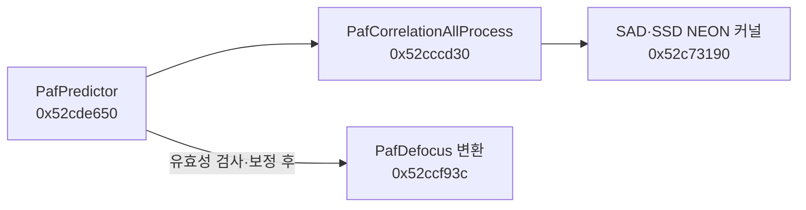

# 공통 요청 이후의 디스패처·셔터·AF

K-3 Mark III v2.20 RTOS에서 요청 수신 분기, 이벤트 큐, 셔터 작업 스레드와 GPIO 경로, AF의 상관·디포커스 연산을 추가 추적했다. 각 경로에서 직접 확인한 연결과 현재 제어 객체·스레드 상태에 의존하는 연결을 아래에 표시한다. 분석한 바이트 구간, 직접 호출·분기, 함수 포인터 값과 생성자 근거는 별도 JSON에 기록했다. [기계어 증거](deep-evidence.json)

## 공통 메시지에서 촬영·AF 이벤트로

기존 제출 경로 `0x52c1e4a8 → 0x52c1cc18`는 메시지 `0x46020102`를 만들고 `0x5330ae48 → 0x53309c10`의 전송 경로를 사용한다. 경로 초기화 함수 `0x52c1b1e0`은 요청 ID 3의 첫 인수 1·2에 목적지 마스크 2를 기록한다. 별도로 확인한 수신 함수 `0x529d26e4`는 같은 메시지 번호를 처리하고, `0x529ea474`에서 요청 ID 3을 선택해 `0x529ea1c4`로 보낸다. **목적지 마스크 2의 전송 등록과 이 수신기를 연결하는 구간은 미해결이다.** 아래는 수신기에 도달했을 때 확인한 분기다. [경로 초기화·수신기 범위](deep-evidence.json)

| 요청 | 수신 후 경로 | 큐에 넣는 값 |
|---|---|---|
| 촬영, 첫 인수 1 | `0x529ea1c4 → 0x529e15bc → 0x528e8de4` | 시작은 이벤트 `0x49`, 정지는 `0x1c3`와 값 0 |
| AF, 첫 인수 2 | `0x529ea1c4 → 0x529e9d28` | cam이면 `0x529e16d8`, area이면 `0x529e9b8c` |
| AF 시작 | 위 cam·area 경로에서 `0x528e8de4` 호출 | 이벤트 `0x11`, 페이로드 `0x529d3164` |
| AF 정지 | 위 cam·area 경로에서 `0x528e8de4` 호출 | 이벤트 `0x1c3`와 값 1 |

여기서 첫 인수는 기존 요청의 **슬롯 0, 메모리 오프셋 +4**다. AF의 다음 슬롯은 cam/area, 그 다음 슬롯은 start/stop이다. AF 시작 페이로드 함수 `0x529d3164`는 이벤트 `0x1c3`와 값 1을 검사하는 판정 함수다. 성공값은 요청 핸들러가 설정하는 응답이다. 큐가 가득 찬 분기에서는 저장을 건너뛰고 진단 함수가 반환할 경우에도 성공값 설정으로 이어질 수 있어, 이 값만으로 큐 반영이나 AF 완료를 확인할 수는 없다. [수신 분기·페이로드·큐 저장 함수](deep-evidence.json)

큐는 싱글턴 `0x545a4698`을 사용한다. 소비 함수 `0x528e901c`는 `0x528e8fc4`를 호출하고, 현재 제어 객체를 얻은 뒤 `0x528e8ff0`에서 가상 함수 슬롯 `+0x24`를 호출한다. 기본 Controller 생성자는 vtable `0x53608c48`을 설치하며 해당 슬롯 값은 `0x526d8ccc`다. 이 값은 생성자와 표에서 확인했지만 실행 시 선택되는 파생 객체와 그 다음 슬롯 `+0x28`은 상태에 따라 달라진다. **촬영 이벤트 `0x49`와 AF 이벤트 `0x11`에서 아래의 셔터·상관 연산으로 가는 전체 연결에는 이 상태 전이 구간이 남아 있다.** [조건부 함수 포인터 연결](deep-evidence.json)

## 셔터 제어 객체에서 GPIO 쓰기까지

벌브 시작 함수 `0x530e3dc8`은 객체의 `+0xb8`에 작업 코드 1을 기록하고 `0x530f3e58`을 통해 작업 스레드에 신호를 보낸다. ShutterControl 생성자 `0x530e3c14`는 vtable `0x53a66988`을 설치한다. 이 표의 `+8`, 주소 `0x53a66990`은 작업 함수 `0x530e5558`이다. 작업 함수는 `+0xb8`을 읽고 코드 1에서 `0x530e4f48 → 0x530e3fe4`로 들어간다. [생성자·작업 코드·직접 호출 위치](deep-evidence.json)

`0x530e3fe4`는 객체 `+0x3c`의 GPIO에 대해 `0x530e4004`에서 가상 슬롯 `+0x54`를 호출한다. 조사한 보드 매핑 7개 중 6개는 논리 번호 `0x62`를 드라이버 등록 키 `0x8d`로, `0x0e`를 키 `0x36`으로 연결한다. 이 초기화가 선택됐다는 조건에서 각각 TopGpio와 PmcGpio 생성자·등록 코드로 이어진다. 다른 한 보드 매핑에는 해당 연결이 없으며 실제 선택된 보드 상태를 수집하지 않았다. [매핑·등록·vtable 근거](deep-evidence.json)

| 셔터 객체의 호출 위치 | 초기화 조건에서 결정되는 함수 | 기계어에서 확인한 레지스터 쓰기 |
|---|---|---|
| `0x530e4004`, GPIO `+0x3c`의 clear | TopGpio `0x53267bbc` | `0x53267bdc`에서 `0x1d022020 ← 0x00020000` |
| `0x530e43ec`, GPIO `+0x3c`의 set | TopGpio `0x53267c40` | `0x53267c6c`에서 `0x1d022020 ← 0x00020002` |
| `0x530e43fc`, GPIO `+0x40`의 set | PmcGpio `0x53268098` | `0x532680c4`에서 `0x1dffb000 ← 0x40004000` |

쓰기 뒤에는 ARM `DSB`가 보인다. 위 값은 해당 드라이버 객체의 초기화된 레지스터 주소와 마스크로 계산한 정적 결과다. 이 분석으로 셔터 제어 코드가 도달하는 전기적 인터페이스를 특정했으며, 각 핀이 선막·후막·솔레노이드·상태 접점 중 무엇에 해당하는지는 회로도나 실측으로 확인해야 한다. 벌브 진단 경로가 일반 촬영 요청의 모든 경우에 실행된다고 가정하지 않았다. [GPIO 원본 범위와 초기화 값](deep-evidence.json)

기존에 추적했던 객체 `+0x4c`는 ReloadTimer로 확인됐다. `+0x48`의 XTrigger 경로에는 `EXT_STRB_FT`라는 플래시 신호명이 있다. 이 두 하위 객체의 존재를 셔터 액추에이터에 직접 연결하는 근거로 사용하지 않았다. [타이머·트리거 관련 구간](deep-evidence.json)

## AF 객체 생성과 실제 수치 연산

PafFactory의 생성자 호출·객체 포인터 저장·vtable 설치를 따라 세 객체의 간접 초기화 대상을 확인했다. 이 표는 해당 팩토리가 생성한 객체에 적용된다. [생성·초기화 근거](deep-evidence.json)

| 객체 | 팩토리의 객체 필드 | 간접 호출 위치 | vtable 슬롯 주소 → 대상 |
|---|---|---|---|
| PafCorrelation | `+0x94` | `0x52ca3218` | `0x5388c9e4 → 0x52cc6e80` |
| PafDefocus | `+0x9c` | `0x52ca3240` | `0x5388d014 → 0x52ccf358` |
| PafPredictor | `+0x738` | `0x52ca3360` | `0x5388f544 → 0x52cdd63c` |

PafPredictor 초기화는 팩토리의 Correlation·Defocus 포인터를 각각 자신의 `+0x18`, `+0x20`에 저장한다. 다음 경로를 직접 호출 명령과 데이터 전달에서 확인했다.



PafPredictor는 상관 결과 후보를 꺼내 보정한 16비트 값을 만들고, `0x52cde7e4`에서 PafDefocus 변환을 호출한다. 이 변환은 설정·렌즈 관련 값을 이용해 곱셈과 스케일 조정을 수행하며, 조건부 보정 뒤 크기 값을 `0xffff`로 제한해 객체 `+0x0e`에 16비트로, 부호 있는 결과를 `+0x10`에 32비트로 저장한다. 광학 단위, 렌즈 보정 계수 전체와 최종 렌즈 구동 명령은 추가 분석 대상이다. [Predictor·Defocus 범위와 직접 호출](deep-evidence.json)

`0x52c73190`의 NEON 커널은 unsigned16 입력 배열에 대해 SAD와 SSD를 계산한다. 각각 `Σ|aᵢ−bᵢ| mod 2³²`, `Σ(aᵢ−bᵢ)² mod 2³²`다. 마지막 8개 레인은 펌웨어의 마스크 표로 처리하므로 읽을 수 있는 패딩 메모리가 필요하다. 0·음수 길이의 의미는 이번 분석 범위에서 검증하지 않았다. [함수·마스크 범위](deep-evidence.json)

실제 커널 바이트를 Unicorn 2.1.4의 Cortex-A7 모델에서 독립 실행했다. 양수 길이 1–129 중 18가지, 동일 배열·최대 차이·교대 값·난수를 조합한 **72개 사례**에서 기준식과 일치했다. 8개 경계의 앞뒤, 비영 패딩, 32비트 오버플로를 포함한다. angr의 VEX 실행은 `Iop_PwAddL16Ux8` 미지원으로 실패했고, 수치 검증에는 Unicorn을 사용했다. 생성된 C의 벡터 연산 표현도 일부 불완전하다. [측정 결과](numerical-checks.json) · [재현 코드](../verify_numeric_kernels.py) · [Unicorn 프로젝트](https://github.com/unicorn-engine/unicorn)

## 재현과 검증 범위

추가로 디컴파일한 서로 다른 진입점은 115개다. 셔터·디스패처 59개, AF 24개, 색 처리 33개 중 공통 진입점 하나를 중복 제거한 수다. 이와 별도로 기존 셸 의사코드 16개를 재사용했다. 공개 증거는 디컴파일 탐색 창 115개, 기존 명령 창 16개, 명령어 보조 구간 18개, 데이터 구간 5개를 합친 154개 구간이다. 창의 끝은 분석 상한이며 일부에는 점프 테이블·인접 코드가 포함된다. 생성된 C는 원래 타입·이름·호출 규약을 완전히 복원하지 못한다. [구간별 방법과 해시](deep-evidence.json)

2,467개 A32 호출·분기 위치와 49개 포인터·상수 단어를 원본 바이트에서 독립 확인했다. 생성자 근거를 붙인 조건부 간접 연결은 16개다. 함수 포인터 슬롯의 값과 간접 호출 명령을 검사했고, 현재 객체가 해당 생성 경로에서 만들어졌다는 조건을 유지했다. [검증 코드](../verify_deep_analysis.py)

기존 추출기로 만든 `decoded.bin`을 입력한다. 첫 검증기는 Python 표준 라이브러리만 필요하다. 두 번째 검증기는 `unicorn==2.1.4`를 사용하며, 수치 커널과 상수 페이지만 매핑해 합성 데이터로 실행한다.

```console
python verify_deep_analysis.py .private/my-decode/decoded.bin
python verify_numeric_kernels.py .private/my-decode/decoded.bin
```

추가 진입점의 의사코드는 `angr==10.0.5` 환경에서 주소로 지정해 다시 생성할 수 있다. 출력은 로컬 경로에 저장한다. 텍스트 구조는 도구 분석 상태에 따라 달라질 수 있으므로 바이트·호출 위치를 우선 비교한다.

```console
python decompile_sample.py .private/my-decode/decoded.bin 0x52cde650 > .private/paf-predictor.c
python decompile_sample.py .private/my-decode/decoded.bin 0x5312cd40 > .private/color-matrix.c
```

구간 해시·명령의 목적지·함수 포인터 단어를 검사하는 것은 저장한 근거의 재현성을 확인한다. 현재 제어 객체와 보드 선택, 비동기 콜백이 특정 촬영에서 실제 실행됐다는 의미는 별도의 실기 추적으로 확인해야 한다. 카메라·렌즈를 구동하거나 펌웨어를 변경하지 않았다. 전체 요청에서 기계적 셔터 동작·합초 결과까지 이어지는 실기 검증은 수행하지 않았다.
